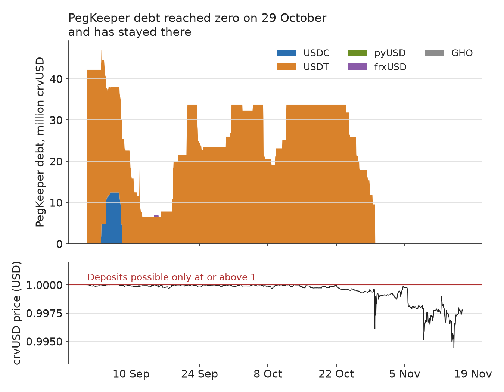
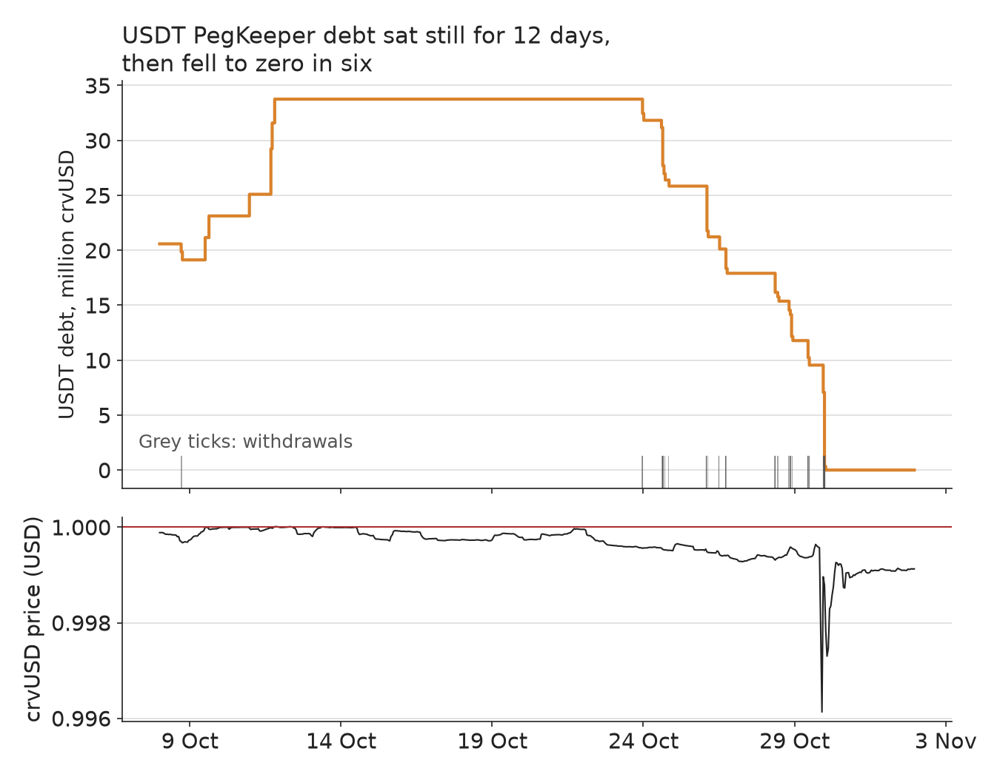
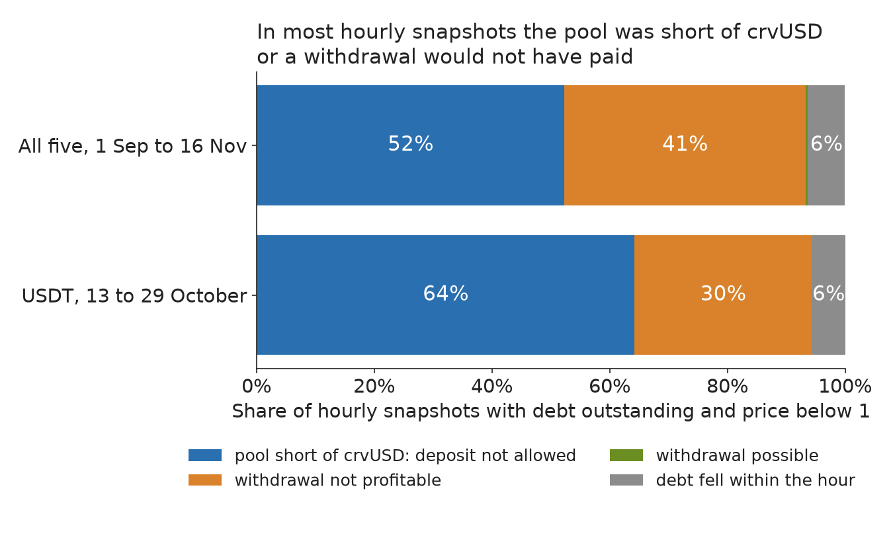

# Why crvUSD's PegKeepers hold no debt, and what that means below the peg

On 16 November 2026 all five crvUSD PegKeepers had zero debt, and have had since 29 October. The aggregated price was about 0.998. Four of them still hold crvUSD they could deposit; what is zero is the crvUSD placed in their pools. With no debt, a PegKeeper can do nothing while crvUSD is under 1.

## How a PegKeeper works

There are five, one per pool pairing crvUSD with USDC, USDT, pyUSD, frxUSD or GHO. A PegKeeper has crvUSD allocated by Curve, up to a ceiling. Deposited into its pool, that crvUSD pushes the price down; withdrawn, it pulls the price up. What a PegKeeper has deposited is its debt, and it can only withdraw that. It may deposit only while crvUSD is at or above 1 and withdraw only at or below 1. The aggregated price, a slow-moving average across the pools, decides whether an action is allowed. The balances of its own pool decide which way it tries to go. Anyone can trigger it.

## What happened

Hourly readings, 1 September to 16 November.

*Top: debt of each PegKeeper, in millions of crvUSD. Bottom: the aggregated crvUSD price. A PegKeeper can deposit only when the price is at or above the red line.*

USDT held almost all the debt: about 42M crvUSD at the start of September, under 7M by mid-September, about 34M by 11 October. The rebuilds happened when the price touched 1, which the hourly line often misses. No hourly reading reached 1 after 13 October, and the events show no deposit after 11 October.

USDT debt was flat from 11 to 23 October, and for about ten of those twelve days the price was under 1.

*USDT PegKeeper debt (top) and the aggregated price (bottom). The grey ticks mark withdrawals. Debt is flat for twelve days while the price stays between 0.9996 and just above 1.*

Pool balances choose the direction, not the price. If the pool holds less crvUSD than the other stablecoin, the contract goes for a deposit. With the price below 1 that is not allowed, so the call fails and does not fall back to a withdrawal. If the pool holds more crvUSD, the contract tries to withdraw, but only if that leaves the PegKeeper better off. In practice the pool has to price crvUSD at a discount; the contract does not say how large.

*How each hourly snapshot with debt outstanding and the price below 1 is classed, from the pool balances, the contract's rule, and a simulated call to the PegKeeper for every withdrawal-side snapshot and for a sample of the deposit-side ones. Blue: the pool is short of crvUSD and the deposit is not allowed. Orange: a simulated withdrawal would not be profitable.*

Across all five PegKeepers, the pool was short of crvUSD in just over half of those snapshots, and in 41% a simulated withdrawal failed the profit check. For USDT the pool was short of crvUSD in 64% from 13 to 29 October, and in about nine in ten from 13 to 23 October. Inferred, not tested: a pool short of crvUSD already prices it at or above 1 while the slow aggregate reads below 1, so a PegKeeper that does not withdraw there is the rule working as written.

The debt began to fall on 23 October, with the price near 0.9996, in bursts over six days. A falling price and a pool filling with crvUSD are both what selling crvUSD into the pools would produce. Whether, or by whom, crvUSD was sold was not traced.

## Below the peg

To build debt again, the price must be at or above 1 and a pool must be short of crvUSD. The price was at or above 1 in about 7% of hourly readings, and no November reading came within 0.01% of 1. At the last block, crvUSD made up between 72% and 84% of each pool. Between 3M and 8M crvUSD would have to leave each of the USDC, USDT, frxUSD and pyUSD pools before it was on the deposit side, and the price and the room under the debt limit must then also allow a deposit. GHO's PegKeeper has a debt ceiling of zero, so it has no crvUSD to deposit. The same flows move the price and the pool balances, so these are one hurdle rather than two (inferred).

Curve's documentation says the borrow rate rises when crvUSD is below 1. Not studied.

## Limits

Readings are hourly. Whether a deposit would be refused follows from the pool balances and the contract's rule; the unprofitable withdrawals come from simulation at one block per hour, which does not show what happened between readings, when 207 real withdrawals took place in openings that hourly sampling mostly missed. Nearly all the evidence is one PegKeeper over one 77-day period of falling prices. All 207 withdrawals happened with crvUSD at 53% of its pool or more; this is an observation, not a rule of the contract, and was not derived from the pool's parameters. The split between the two kinds of failed call was chosen after seeing the first data.

20 predictions were written before any data. Fourteen held and six did not. The miss that mattered most was the prediction that debt would not sit still for more than three days while the price was under 1 and the pool was on the withdrawal side.
